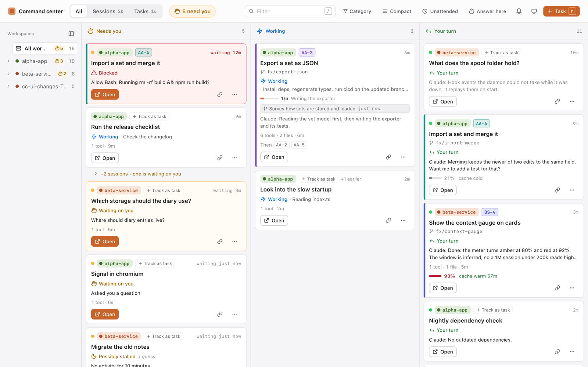

# Command Center

A board for your Claude Code sessions and the tasks they work on, on your Mac. Each session shows up as a card in one of three lanes: **Needs you** (waiting on a question or a permission), **Working**, and **Your turn**. Tasks sit next to them with their branch and PR. A small pill on the edge of your screen shows the same lanes as dots, so you see when a session is waiting without switching windows.



Everything runs on your Mac. Nothing is sent anywhere.

## What it needs

- A Mac with Apple Silicon (M1 or later), on macOS 14 or newer
- Claude Code, either the desktop app's Code tab or the `claude` CLI
- Optional: the GitHub CLI (`gh`), logged in, for PR states on the board. Without it the board works and leaves PR states out.

## Install

1. Download `Command-Center-<version>-arm64.dmg` from the [latest release](https://github.com/rodrigo-om/command-center-releases/releases/latest).
2. Open the DMG and drag **Command Center** into **Applications**.
3. Open it from Applications. The app isn't notarized by Apple, so macOS stops it the first time with a message that it can't verify the app. Click **Done**, then open **System Settings → Privacy & Security**, scroll down to the line about Command Center and click **Open Anyway**. You only do this once.

   If you'd rather use Terminal, this does the same:

   ```
   xattr -dr com.apple.quarantine "/Applications/Command Center.app"
   ```

4. The app asks to connect Claude Code. It adds:
   - hooks in `~/.claude/settings.json` that report each session's events (it keeps a backup at `~/.claude/settings.json.command-center-backup`),
   - the `command-center` MCP server, so sessions can read and update the board,
   - the `command-center` skill, which explains the board to Claude,
   - a background service that runs the board while you're logged in.

   **Not now** opens the board without touching Claude Code. You can connect later from the menu bar.

New sessions show up on the board as soon as they start. Sessions that were already open show up on their next event.

## Updates

The app checks for a new version a minute after it starts and every six hours, installs it and restarts itself. **Check for updates…** in the menu bar does it right away.

## When something's off

- **The board is empty:** sessions appear once they do something. Start a new one, or send a message in an open one.
- **"Another app is using the board's port":** the board runs on port 4777. Quit the app the window names, and the board comes up by itself.
- **PR states are missing:** install the GitHub CLI and log in: `brew install gh && gh auth login`.
- **Anything else:** choose **Copy debug info** in the menu bar and paste it to whoever gave you the app. It has versions, how the app is wired and the last lines of its log, and nothing from your sessions or tasks.

## Uninstall

Choose **Disconnect Claude Code…** in the menu bar, quit the app and move it to the Trash. The board's data stays in `~/.command-center`; delete that folder too if you don't want it.
